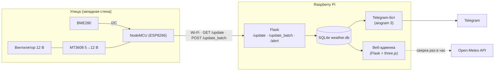

# Метеостанция «Солигорск»

Уличный датчик температуры в самодельном аспирационном радиационном экране, приём данных и Telegram-бот на Raspberry Pi, веб-админка с 3D-визуализацией. Расчётный режим — зима: морозы до −30 °C, ясные морозные дни при полном штиле, снежное альбедо до 1.8.


## Архитектура



## Возможности

### Прошивка — `firmware/`, v2.1

- Опрос BME280 в forced mode, продувка 24/7 без циклов пуска и остановки
- Store-and-forward: если приёмник недоступен, замеры буферизуются на флеше и отправляются батчем через `POST /update_batch` с временем из NTP
- Журнал событий во флеше, аппаратный WDT, телеметрия (RSSI, heap, uptime, версия)
- OTA-команды в `platformio.ini`, закомментированы до эксплуатации

### Бот — `bot/TestV3.py` (aiogram 3 + Flask)

- Приём данных с ключом станции и валидацией диапазонов, watchdog «станция молчит»
- Алерты: тишина, ошибка датчика, скачок температуры, мороз, дневной дайджест 21:00
- Точка росы, тренд давления, восход/закат, рекорды 24ч, /stats
- `/alert` — труба алертов из прошивки ESP
- Ночные бэкапы БД с ротацией, «Бэкап сейчас» файлом, экспорт CSV/Excel
- Веб-админка `bot/web`: дашборд, пользователи, данные, бэкапы

### Веб-админка — `web54/` (шаблоны и статика)

- Страница «Активность»: 3D-сцена на three.js r128 без сборщиков — ядро-звезда, узлы пользователей, импульсы сообщений по дуге; собственный bloom, тонмаппинг ACES, четыре раскладки (орбиты, сфера, спираль, галактики), события через SSE
- Многостраничная админка: дашборд с графиками, пользователи, данные, бэкапы
- Полный бэкенд админки живёт в TestV4 — эта версия не публикуется; для TestV3 есть стендовый сервер `web54/test_server.py`, поднимающий те же шаблоны на V3-бэкенде
- Шаблоны ставятся в свою копию инсталляторами `install_admin_ui.py` / `install_activity_ui.py`

## Железо

| Компонент | Решение |
| --- | --- |
| Контроллер | NodeMCU (ESP8266) |
| Датчик | BME280 |
| Экран | Аспирационный радиационный, белый, продувка всегда включена |
| Приёмник | Raspberry Pi, Wi-Fi 2.4 ГГц, локальная сеть |

## Установка

### Прошивка (PlatformIO)

```bash
cd firmware
cp include/secrets.h.example include/secrets.h   # вписать Wi-Fi, ключ станции, пароль OTA
pio run -t upload
```

### Бот (Python 3)

```bash
python bot/TestV3.py
```

Перед запуском впишите в начало `bot/TestV3.py` свои значения: `TOKEN` (токен из BotFather), `SENSOR_KEY` (ключ станции — тот же вписать в прошивку), `ADMIN_PASS` (пароль администратора) и `CITY_LAT` / `CITY_LON` (координаты вашего города — для восхода/заката).

Flask слушает 5002, админка — `/admin`.

### Стендовый сервер админки

```bash
python web54/test_server.py                      # http://127.0.0.1:5003/admin
```

### Версии бота

| Версия | Порт | Отличия |
| --- | --- | --- |
| TestV1 | 5000 | приём данных и алерты, работающая версия |
| TestV2 | 5001 | ключ на /update, проверка значений, watchdog, бэкапы БД |
| TestV3 | 5002 | точка росы, /alert для ESP, Excel-экспорт |
| TestV4 | 8080 | рабочая версия: графики, сверка с Open-Meteo, прогноз 24ч, тумблеры, WAL — не публикуется |

<details>
<summary>Структура репозитория</summary>

```
├── firmware/               # прошивка ESP8266 (PlatformIO, env nodemcuv2)
│   ├── src/main.cpp
│   ├── include/            # config.h, secrets.h (.example в репо)
│   └── platformio.ini
├── bot/                    # Telegram-бот и приём данных
│   ├── TestV1.py … TestV3.py
│   ├── web/                # шаблоны и стили админки V1–V3
│   └── backups/            # история кода
└── web54/                  # админка V4
    ├── templates/ static/  # вёрстка, стили, 3D-сцена
    ├── install_admin_ui.py install_activity_ui.py
    ├── test_server.py      # стендовый сервер (порт 5003)
    └── smoke_activity.py   # смоук-тест страницы «Активность»
```

</details>

## Roadmap

- [ ] RPM-мониторинг вентилятора аспирации (после перехода на вентилятор с тахометром)
- [ ] Суточная поправка температуры по сверке с Open-Meteo (отображаемая, сырые данные не меняются)
- [ ] OTA-обновления прошивки в эксплуатационном режиме
- [ ] Вторая станция в открытом поле: ветромер, осадкомер, независимый канал связи

## Лицензия

[MIT](LICENSE) — используйте, модифицируйте и собирайте своё.

