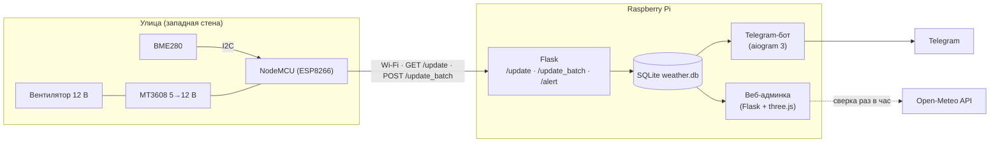

# Метеостанция «Солигорск»

Уличный датчик температуры в самодельном аспирационном радиационном экране, приём данных и Telegram-бот на Raspberry Pi, веб-админка с 3D-визуализацией. Расчётный режим — зима: морозы до −30 °C, ясные морозные дни при полном штиле, снежное альбедо до 1.8.


## Архитектура



## Возможности

### Прошивка — `firmware/`, v2.1

- Опрос BME280 в forced mode, продувка 24/7 без циклов пуска и остановки
- Store-and-forward: если приёмник недоступен, замеры буферизуются на флеше и отправляются батчем через `POST /update_batch` с временем из NTP
- Журнал событий во флеше, аппаратный WDT, телеметрия (RSSI, heap, uptime, версия)
- OTA-команды в `platformio.ini`, закомментированы до эксплуатации

### Бот — `bot/TestV4.py` (aiogram 3 + Flask)

- Приём данных с проверкой диапазонов, watchdog «станция молчит», алерты восьми категорий — каждая включается отдельно
- Точка росы, прогноз-текст и график прогноза 24ч из Open-Meteo, рекорды, графики, недельный дайджест
- Переключение источника данных станция ↔ Open-Meteo: датчик у западной стены греется после полудня, в режиме Open-Meteo погодные функции берут официальные данные
- Блокировка пользователей: заблокированному бот не отвечает

### Веб-админка — `web54/`

- Дашборд с шестью графиками, включая прогноз на 24 часа, сверку с Open-Meteo и разность «наша − официальная»
- Страница «Активность»: 3D-сцена на three.js r128 без сборщиков — ядро, узлы пользователей, импульсы сообщений по дуге; собственный bloom, тонмаппинг ACES, четыре раскладки (орбиты, сфера, спираль, галактики), события через SSE
- Пользователи с блокировкой, ручной ввод записей, бэкапы, экспорт CSV/XLSX
- Шаблоны ставятся в свою копию инсталляторами `install_admin_ui.py` / `install_activity_ui.py`

## Железо

| Компонент | Решение |
| --- | --- |
| Контроллер | NodeMCU (ESP8266) |
| Датчик | BME280 |
| Экран | Аспирационный радиационный, белый, продувка всегда включена |
| Приёмник | Raspberry Pi, Wi-Fi 2.4 ГГц, локальная сеть |

## Установка

### Прошивка (PlatformIO)

```bash
cd firmware
cp include/secrets.h.example include/secrets.h   # вписать Wi-Fi, ключ станции, пароль OTA
pio run -t upload
```

### Бот (Python 3)

```bash
cp bot/secrets_local.example.py bot/secrets_local.py
python bot/TestV4.py
```

В `bot/secrets_local.py` заполняются все локальные значения: токен из BotFather, пароль администратора, ключ станции и **координаты вашего города** (`HOME_LAT` / `HOME_LON` — для восхода/заката и сверки с Open-Meteo). Без координат код использует округлённый центр по умолчанию — погода будет чужая, поэтому впишите свои.

Flask слушает 8080, админка — `/admin`. Всё из `secrets_local.py` — под `.gitignore`, в репозиторий не попадает.

### Версии бота

Витрина показывает актуальный **TestV4**. Ранние версии (TestV1–V3: приём данных, watchdog, бэкапы, точка росы, `/alert`) развивались локально и в репозиторий не входят.

<details>
<summary>Структура репозитория</summary>

```
├── firmware/               # прошивка ESP8266 (PlatformIO, env nodemcuv2)
│   ├── src/main.cpp
│   ├── include/            # config.h, secrets.h (.example в репо)
│   └── platformio.ini
├── bot/                    # Telegram-бот и приём данных
│   ├── TestV4.py           # актуальная версия (aiogram 3 + Flask, порт 8080)
│   └── secrets_local.example.py
└── web54/                  # админка V4
    ├── templates/ static/  # вёрстка, стили, 3D-сцена
    ├── install_admin_ui.py install_activity_ui.py
    └── smoke_activity.py   # смоук-тест страницы «Активность»
```

</details>

## Roadmap

- [ ] RPM-мониторинг вентилятора аспирации (после перехода на вентилятор с тахометром)
- [ ] Суточная поправка температуры по сверке с Open-Meteo (отображаемая, сырые данные не меняются)
- [ ] OTA-обновления прошивки в эксплуатационном режиме
- [ ] Вторая станция в открытом поле: ветромер, осадкомер, независимый канал связи

## Лицензия

[MIT](LICENSE) — используйте, модифицируйте и собирайте своё.

